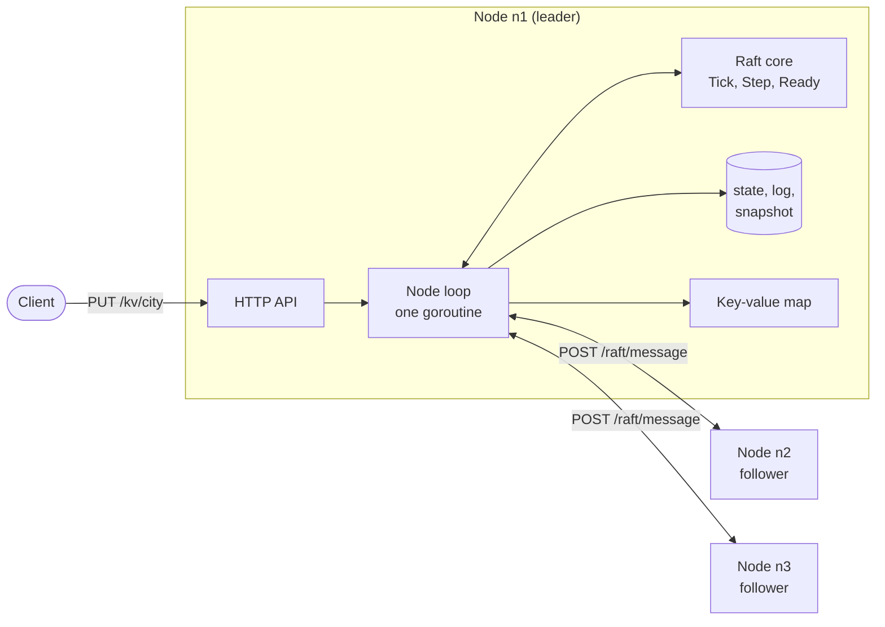

# QuorumKV

QuorumKV is a replicated key-value store written in Go. Three nodes keep a copy of the data and agree on every change with the Raft consensus algorithm, which I implemented from scratch instead of using a library. I built it to learn what a replicated database has to get right: one leader at a time, no acknowledged write lost when a machine dies, no stale answer when the network splits, and a node that was down catching up on its own when it comes back.

[](https://github.com/hmzckd/quorumkv/actions/workflows/ci.yml)

## What it includes

- Leader election with randomized timeouts, one vote per node per term, and a vote only for candidates whose log is at least as up to date
- Log replication with a majority commit rule, conflict repair, and a no-op entry at the start of every term
- A Raft core with no clock, no network and no disk: it only reacts to `Tick()` and `Step(message)` and returns what to save, send and apply
- Durable files of its own: an append-only log with a CRC32 per record and `fsync` on every append, a state file replaced atomically, and a torn tail cut off at startup
- Linearizable reads with ReadIndex, so a leader cut off from the majority never answers with old data
- Snapshots every 1000 entries, log compaction, and InstallSnapshot for a follower that fell too far behind
- A deterministic simulator with a fake network and clock: partitions, crashes, restarts and lost or delayed messages, replayable from a seed
- Safety rules checked after every simulated tick, 200 random fault runs in CI, and a linearizability check of client histories with [porcupine](https://github.com/anishathalye/porcupine)
- An HTTP API with redirects from followers to the leader, `503` with `Retry-After` during elections, and `problem+json` errors
- `qkdump`, a tool that prints a node's state, snapshot and log files

## How it fits together



A write goes to the leader. The leader appends it to its log, calls `fsync`, and sends it to the followers, which do the same and reply. Once a majority (two of three nodes) has the entry on disk, it is committed: the leader applies it to the map and answers `204`. If the leader dies, the two remaining nodes elect a new one within a few hundred milliseconds, and the new leader is guaranteed to hold every committed entry.

Each node runs one goroutine that owns the Raft core. It feeds the core clock ticks, incoming messages and client requests, then handles the core's output in a fixed order: save the term, vote and new entries to disk, send messages, apply committed entries. Because only this goroutine touches the core, the core needs no locks, and the same core runs unchanged inside the simulator.

## Guarantees

1. **Durability:** if `PUT` returned `204`, the value is on the disk of a majority and survives any crash.
2. **Linearizability:** a `GET` returns the latest acknowledged value, even while the network is split.
3. **Availability:** with one of three nodes down, reads and writes keep working. With two down, requests get `503`, never a wrong answer.
4. **Unknown outcome:** after a `503` "Outcome unknown", the write may or may not have happened. `PUT` and `DELETE` are idempotent, so the client can safely retry.

## Stack

| Area | Technology |
| --- | --- |
| Service | Go 1.27 standard library (`net/http`, `log/slog`, `encoding/json`, `hash/crc32`) |
| Consensus | Own Raft implementation, no consensus library |
| Storage | Own append-only log, state and snapshot files |
| Tests | `go test`, a deterministic simulator, porcupine (the only third-party module, used in tests) |
| Container | Multi-stage Dockerfile, distroless image running as a non-root user (about 21 MB) |
| CI | GitHub Actions: `gofmt`, `go vet`, `go test -race` |

## Repository layout

```text
.
├── cmd/quorumkv/         the server
├── cmd/qkdump/           prints a node's state, snapshot and log
├── internal/raft/        the Raft core: election, replication, commit, ReadIndex, snapshots
├── internal/storage/     state, log and snapshot files
├── internal/kv/          the map and the put and delete commands
├── internal/node/        the node loop that connects the core to disk, network and clients
├── internal/transport/   Raft messages between nodes over HTTP and JSON
├── internal/httpapi/     client API, status and health endpoints
├── internal/config/      configuration from environment variables
├── internal/sim/         simulator, random fault tests and the linearizability check
├── docs/adr/             architecture decision records
├── GLOSSARY.md           Raft and project terms
├── Dockerfile
├── compose.yaml          a three-node cluster
└── .github/workflows/ci.yml
```

## Run locally

### Requirements

- Docker Desktop
- Go 1.27 or newer, for the tests and for running without Docker

The commands below are for PowerShell. They call `curl.exe`, which ships with Windows 10 and later.

### 1. Start a three-node cluster

```powershell
docker compose up -d --build
```

Node `n1` listens on `http://localhost:7001`, `n2` on `7002` and `n3` on `7003`. Each node keeps its files in its own named volume.

### 2. Find the leader

```powershell
curl.exe http://localhost:7001/status
```

```json
{"id":"n1","role":"follower","term":1,"leader":"n3","lastIndex":1,"commitIndex":1,"applied":1,"snapshotIndex":0,"keys":0}
```

### 3. Write and read through any node

```powershell
curl.exe -L -X PUT --data "istanbul" http://localhost:7001/kv/city -w "%{http_code}`n"
curl.exe -L http://localhost:7002/kv/city
```

A follower answers `307 Temporary Redirect` with the leader's address, and `-L` makes curl follow it. Drop `-L` and add `-i` to see the redirect itself.

### 4. Stop the leader

In the example output the leader is `n3`. Use the leader you found in step 2, and send the next requests to a node that is still running:

```powershell
docker compose stop n3
curl.exe http://localhost:7001/status
curl.exe -L -X PUT --data "ankara" http://localhost:7001/kv/city -w "%{http_code}`n"
```

The two remaining nodes elect a new leader in a higher term, and the write still returns `204`.

### 5. Stop the new leader

The status from step 4 names the new leader. Stop it too, here `n2`:

```powershell
docker compose stop n2
curl.exe -i http://localhost:7001/kv/city
```

The last node cannot win an election on its own, so it answers `503` "No leader" with `Retry-After: 1` instead of a value it cannot confirm. If you stop the follower instead, the leader keeps its role but cannot confirm a read with a majority: it waits 2 seconds and answers `503` "Timeout".

### 6. Bring both back

```powershell
docker compose start n2 n3
curl.exe -L http://localhost:7003/kv/city
docker compose exec n3 qkdump /data
```

The returning nodes catch up from the leader and `n3` answers `ankara`. `qkdump` shows the entries they received, including the no-op entry each new leader writes at the start of its term.

`docker compose down` stops the cluster and keeps the data. `docker compose down -v` deletes the volumes too.

### Run the nodes with Go instead

Open three PowerShell windows in the repository folder and start one node in each, with `n1` and `:7001`, `n2` and `:7002`, `n3` and `:7003`:

```powershell
$env:QK_PEERS = "n1=http://localhost:7001,n2=http://localhost:7002,n3=http://localhost:7003"
$env:QK_NODE_ID = "n1"; $env:QK_ADDR = ":7001"
go run ./cmd/quorumkv
```

Each node writes its files to `data\<id>`. Read them with `go run ./cmd/qkdump data\n1`.

| Variable | Default | Meaning |
| --- | --- | --- |
| `QK_NODE_ID` | required | This node's ID, for example `n1` |
| `QK_PEERS` | required | Every node as `id=url` pairs, including this one; nodes send Raft messages to these URLs |
| `QK_CLIENT_URLS` | `QK_PEERS` | The URL clients use for each node, used in redirects; compose sets it to `localhost` addresses |
| `QK_ADDR` | `:7001` | Listen address |
| `QK_DATA_DIR` | `data/<id>` | Folder for the state, log and snapshot files |
| `QK_HEARTBEAT` | `50ms` | How often the leader sends heartbeats |
| `QK_ELECTION_TIMEOUT` | `150ms` | Base election timeout; each wait is random between one and two times this value |
| `QK_SNAPSHOT_EVERY` | `1000` | Applied entries between snapshots |
| `QK_LOG_LEVEL` | `info` | `debug`, `info`, `warn` or `error` |

## API overview

| Endpoint | Response |
| --- | --- |
| `PUT /kv/{key}` (body: the value) | `204` once committed and applied; `307` from a follower; `503` with `Retry-After: 1` while there is no leader; `503` "Outcome unknown" if the entry is not committed within 2 seconds or the leader loses its role |
| `GET /kv/{key}` | `200` with the value, or `404`; served by the leader through ReadIndex; `307` from a follower |
| `DELETE /kv/{key}` | `204`, also when the key did not exist; `307` from a follower |
| `GET /status` | role, term, leader, last log index, commit index, last applied index, snapshot index, number of keys |
| `GET /health` | `200` while the process is running |
| `POST /raft/message` | internal: one Raft message from another node |

Errors use `application/problem+json`.

## How it is tested

| Layer | What it catches |
| --- | --- |
| Raft core unit tests, driven by hand with `Tick` and `Step` | One rule at a time: voting, term comparison, log matching, commit, ReadIndex, snapshots |
| Storage tests | Torn writes, a flipped byte caught by the CRC, conflicting suffixes, and a crash between writing a snapshot and rewriting the log |
| Simulator scenarios, 3 and 5 nodes | Partitions, crashes and message loss in named situations, such as a leader stuck in a minority |
| Random fault runs (`TestRandomFaults`) | 200 seeds, each 3000 ticks (30 seconds of cluster time) of random crashes, restarts, partitions, lost and delayed messages, with election safety, state machine safety and leader completeness checked after every tick, then a check that the healed cluster accepts a new write |
| Linearizability check (`TestLinearizableUnderFaults`) | Five simulated clients run `PUT` and `GET` during faults, and porcupine checks that one sequential map could have produced the results |
| Node and HTTP tests | Three real nodes over HTTP: redirects, `503` cases, writes, reads, restarts and snapshot catch-up |

The simulator owns the clock and the network and draws every random choice from one seed, so a failing run prints a command that replays it exactly:

```powershell
go test ./internal/sim -run TestRandomFaults -seed=42 -v
```

`TestStaleReadsAreCaught` shows that the linearizability check has teeth: it lets a node that believes it is the leader answer reads from its own map without ReadIndex, and porcupine reports the stale reads that follow.

## Checks

```powershell
go vet ./...
go test -race ./...
```

The full run takes about 20 seconds with the race detector. `go test -short ./...` runs fewer seeds.

## Design decisions

| ADR | Decision |
| --- | --- |
| [0001](docs/adr/0001-raft-core-without-clock-or-network.md) | The Raft core has no clock, network or disk, so the same code runs in tests, in the simulator and in the server |
| [0002](docs/adr/0002-own-append-only-log-with-crc-and-fsync.md) | An own append-only log with a CRC per record and `fsync` before acknowledging, instead of an embedded database |
| [0003](docs/adr/0003-linearizable-reads-with-readindex.md) | Reads go through ReadIndex, which confirms leadership with a heartbeat round, instead of leader leases that depend on clocks |

## Deliberately left out

- **Changing the cluster while it runs.** Adding or removing nodes safely needs joint consensus or single-server changes, a large part of Raft on its own. The members are fixed by `QK_PEERS`.
- **Sharding.** One Raft group holds every key, so every write goes through one leader. Scaling writes would need many groups and a router in front of them.
- **Transactions** across several keys.
- **Non-idempotent commands** such as "increment". Retrying one after "Outcome unknown" could apply it twice. It would need client IDs and sequence numbers so the leader can drop duplicates.
- **Snapshots sent in chunks.** A snapshot travels in one message, which is fine while the map fits in memory.
- **Reads from followers.** Every read goes to the leader. Followers could serve reads by asking the leader for a read index first.
- **Pre-vote and check-quorum.** A node that was cut off raises its term and, when it returns, makes the leader step down for one election. This costs a short pause, not safety.
- **Authentication and TLS** between nodes and for clients. Run it on a private network only.
- **gRPC.** JSON over HTTP is enough here and easy to inspect with curl.
